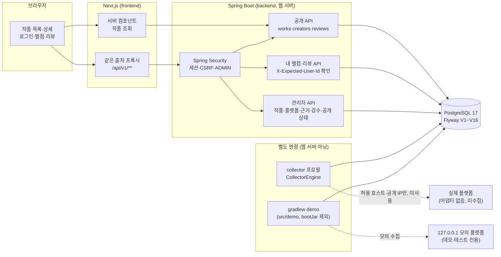
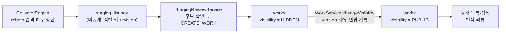

# 만화넷 프로젝트 소개

> 기준 커밋 [`0a1c7f7`](https://github.com/jun1378527/manhwanet/commit/0a1c7f7) (2026-10-16). 이 문서는 현재 코드와 저장소 문서·이슈 기록에서 확인한 내용만 적습니다. **공개 서비스로 운영한 적이 없고, 실제 플랫폼에서 작품을 수집한 적도 없습니다.**

## 1. 문제와 목표

**문제.** 한국 웹툰과 일본 만화는 여러 플랫폼에 흩어져 있습니다. 같은 작품이 플랫폼마다 다른 제목·ID·등급 표기로 올라와 있어, 한곳에서 찾고 평가하기 어렵습니다. 작품 정보를 여러 곳에서 모으면 다음 세 가지가 함께 문제가 됩니다.

- 중복과 오연결: 제목만 비슷한 다른 작품을 합치거나, 같은 작품을 둘로 등록할 수 있습니다.
- 출처와 이용 조건: 어디서 가져온 정보인지, 그 사이트에 요청해도 되는지 확인해야 합니다.
- 공개 범위: 성인 등급이나 확인되지 않은 정보가 검수 전에 노출될 수 있습니다.

**목표.** 작품을 통합해 검색하고 별점·리뷰를 남기는 서비스입니다(README의 장기 목표에는 댓글·랭킹도 있습니다). 지금 단계의 목표는 서비스 기능보다 **데이터를 안전하게 들여오는 경로**를 먼저 만드는 것이었습니다.

> 수집 → 비공개 대기(staging) → 관리자 검수 → 숨김(HIDDEN) 등록 → 명시적 공개 → 독자가 보고 평가

## 2. 주요 기능 (구현됨)

| 영역 | 기능 | 근거 |
| --- | --- | --- |
| 작품·작가 조회 | 공개 목록·상세 API와 화면(`/works`, `/works/{id}`), 페이지 이동, 작가 역할 표시 | [work-creator-spec.md](../work-creator-spec.md) |
| 회원·인증 | 가입·로그인·로그아웃, 서버 세션 쿠키, CSRF(쿠키→`X-XSRF-TOKEN`), Argon2 해시, 관리자 계정은 별도 명령으로만 생성 | [auth-design-draft.md](../auth-design-draft.md) |
| 로그인 보호 | 계정별 실패 제한·잠금 보존, 전역 해시 처리 상한, 429/503 구분과 `Retry-After` (#28) | [login-limit-design-draft.md](../login-limit-design-draft.md) |
| 별점 | 0.5~5.0 별점 등록·수정·삭제, 목록·상세의 평균·참여자 수 | [rating-design-draft.md](../rating-design-draft.md) |
| 리뷰 | 내 리뷰 작성·수정·삭제(버전 충돌 409), 작품별 공개 목록, 스포일러 가림 | [review-design-draft.md](../review-design-draft.md) |
| 계정 일치 확인 | 내 별점·리뷰 변경에 `X-Expected-User-Id` 필수. 세션 사용자와 다르면 409 `USER_MISMATCH` (#22) | [사례 1](case-studies.md#사례-1) |
| 관리자 데이터 관리 | 작품·작가 버전 기반 수정, 플랫폼 10곳·연결·상태 이력, 외부 ID·공식 링크·필드별 근거, 관리 변경 기록 (#38~#40) | [work-platform-admin-spec.md](../work-platform-admin-spec.md) |
| 수집 실행·staging | 플랫폼별 수집 설정(기본 DISABLED), 실행 잠금·재개·중단, 작업 큐, staging 식별 키·등급 신호·변경 이력 (#45) | [collection-staging-spec.md](../collection-staging-spec.md) |
| 수집기 공통 기반 | 어댑터 계약, 허용 호스트·공개 IP만 연결, robots.txt, 플랫폼당 동시 1건·최소 5초 간격, 429·403·CAPTCHA 시 중단(우회 없음), 하루 상한 (#46) | [collector-core-spec.md](../collector-core-spec.md) |
| 검수·등록 | 중복 후보(제목만으로 병합 안 함), 기존 작품 연결·새 작품 등록·보류·제외를 한 트랜잭션으로, 수집 revision 충돌 409 (#51) | [staging-review-spec.md](../staging-review-spec.md) |
| 공개 상태 | 작품 `PUBLIC`·`HIDDEN`. 새 작품은 처음부터 HIDDEN, 공개는 관리자가 version·사유와 함께 명시적으로 (#41 최소 범위) | [work-platform-admin-spec.md](../work-platform-admin-spec.md) §3.1 |
| 포트폴리오 데모 | 분리된 데모 DB, 127.0.0.1 모의 플랫폼, `[DEMO]` 가상 작품으로 위 흐름 재현 (#67) | [demo-guide.md](../demo-guide.md) |

관리자 기능은 API와 명령(CLI)으로만 제공합니다. 관리자 화면은 없습니다.

## 3. 기술 구성

| 영역 | 기술 (README 기준) |
| --- | --- |
| Backend | Java 21, Spring Boot 3.5.16, Spring Web·Security·Data JPA·JDBC·Validation, Flyway(V1~V16), Gradle 8.14.3 |
| Frontend | Next.js 16.3.8 (App Router, 서버 렌더링), React 19.2.8, TypeScript 5, Node.js 24 |
| DB | PostgreSQL 17 (개발 `manhwanet` / 테스트 `manhwanet_test` / 데모 `manhwanet_demo` 분리) |
| 로컬 인프라 | Docker Compose (PostgreSQL만) |
| 구조 | 모듈형 모놀리스: `com.manhwanet.<도메인>` (`auth`, `user`, `work`, `creator`, `rating`, `review`, `platform`, `provenance`, `audit`, `collection`, `global`) |

### 아키텍처



데이터가 공개되기까지의 흐름입니다.



## 4. 실행 방법

전체 절차와 문제 해결은 [README](../../README.md#빠른-시작)와 [데모 가이드](../demo-guide.md)에 있습니다. 아래는 Windows PowerShell, 저장소 루트 기준 요약입니다.

```powershell
Copy-Item .env.example .env            # DB_PASSWORD 등 로컬 값 입력
docker compose up -d
.\scripts\demo\create-demo-db.ps1      # 데모 DB가 없으면 만듦(데이터를 지우지 않음)

cd backend
.\gradlew.bat demo -Pstep=all          # 모의 수집 → 검수(HIDDEN 등록) → 명시적 공개, 약 30초
.\gradlew.bat bootRun --args="--spring.profiles.active=local,demo"

# 새 PowerShell 창(데모 비밀번호 환경변수가 없는 창)
cd frontend
npm install
npm run dev                             # http://localhost:3000/works
```

- 계정 비밀번호는 저장소에 없습니다. 환경변수로 정하거나, 계정을 처음 만들 때 생성된 값이 한 번만 출력됩니다.
- 초기화는 `.\scripts\demo\reset-demo-db.ps1` 로 하고, 데모 DB 이름을 직접 확인해야 진행합니다.
- 테스트: `cd backend; .\gradlew.bat clean build` (테스트 DB 필요), `cd frontend; npm test`

## 5. 현재 완성 범위와 미구현 범위

### 완성 (코드와 자동 테스트가 있음)

- 위 §2 표의 기능
- 가상 데이터로 수집 → 검수 → HIDDEN 등록 → 공개 → 목록·상세 → 로그인·별점·리뷰를 재현하는 데모 환경

### 미구현 또는 미완료

| 항목 | 상태 |
| --- | --- |
| 실제 플랫폼 어댑터·수집 | **없음.** 어댑터 계약과 공통 수집기만 있고, 실제 사이트에는 요청하지 않았습니다(#47~#50 계획). 10곳의 수집 설정 기본값은 DISABLED입니다 |
| 공개 운영 | **하지 않음.** 배포·도메인·운영 모니터링이 없습니다. 웹 서버는 `local` 프로필에서 127.0.0.1에만 바인딩됩니다 |
| 관리자 화면 | 없음. 관리 기능은 API·명령으로만 씁니다 |
| 검색·댓글·랭킹 | 없음 |
| #41 나머지 | 전체 작품 중복 후보 조회, 중복 표시(`duplicate_of`), 판본·시즌 판단 규칙 |
| 표지·줄거리 공개 | 표지 다운로드(#55)·줄거리 공개 정책 미결정. staging에 URL·원문만 보관 |
| 성인·미분류 작품 공개 | 공개 표시 정책(D-15)이 정해지지 않아, GENERAL 작품만 공개로 바꿀 수 있습니다 |
| 수집 근거 종류 `COLLECTOR` | 미결정(D-19). 검수자가 기존 근거 종류(STAFF 등)로 기록합니다 |
| 로그인 IP 기반 보조 제한 | 프록시 신뢰 경계를 정한 뒤 진행(#29, 열림) |

## 6. 검증 기록

테스트 수는 환경과 기준 커밋을 함께 적습니다. 개수만으로 품질을 주장하지 않습니다. 각 테스트가 무엇을 확인하는지는 README의 "테스트 실행" 표와 각 명세의 테스트 절에 있습니다.

| 대상 | 환경 | 기준 | 결과 | 출처 |
| --- | --- | --- | --- | --- |
| 백엔드 `clean build` | Windows, PowerShell 5.1, OpenJDK 21.0.12.1, Docker PostgreSQL 17.11 | `0a1c7f7`과 같은 실행 코드(커밋 직전 검증, 이후 문서만 수정) | JUnit 866, 실패·오류·건너뜀 0 | [#67 커밋 기록](https://github.com/jun1378527/manhwanet/issues/67) |
| 백엔드 `clean test bootJar` | 클라우드 Linux, 격리 PostgreSQL 17 | `0a1c7f7`과 같은 `backend/src` (파일 해시 비교) | JUnit 866, 실패 0 | #67 구현 기록 |
| 프론트 `npm test`, `eslint` | 클라우드 Linux, Node 24.21.0 | `0a1c7f7`과 같은 `frontend/src` | node:test 134, 실패 0, lint 오류 0 | 이 문서 작성 시 실행 |
| 데모 흐름 (문서 순서) | Windows 동일 환경 | 위와 같음 | 수집 COMPLETED → 작품 3 HIDDEN → 공개 → 브라우저 로그인·별점 4.5·리뷰, 초기화 후 재구성 | #67 |

확인하지 않은 것: Windows `next build`/`start`, 리뷰 수정·삭제를 포함한 전체 화면 회귀, 모바일 화면, 별도 OS 프로세스로 띄운 `collector` 프로필, 실제 플랫폼 요청. 서버가 떠 있는 동안의 HIDDEN 상세 HTTP 404와 공개 후 200, 로그인·별점·리뷰는 2026-10-16 데모 DB 리허설에서 확인했습니다.
